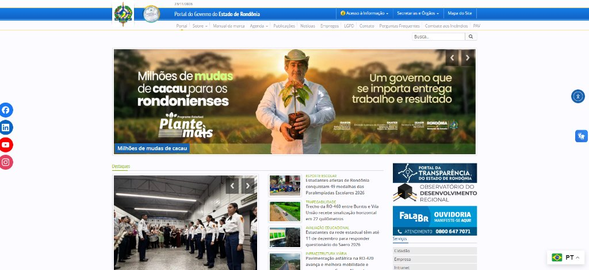

# Redesign Conceitual — Portal do Governo do Estado de Rondônia (UX/UI & Acessibilidade)

Protótipo conceitual da página inicial do **Portal do Governo do Estado de Rondônia**, desenvolvido para estudo de caso de portfólio em **UX/UI Design** e **Desenvolvimento Front-end (GovTech)** com foco em acessibilidade (**WCAG AA/AAA**), utilizando apenas **HTML5 semântico**, **CSS3 puro** e **JavaScript vanilla**.

- **Prévia ao vivo:** `https://ticiacruzcosta.github.io/redesign_portal_rondonia/`
- **Referência analisada:** `https://rondonia.ro.gov.br/portal/`

> **Aviso:** Este é um projeto conceitual de portfólio, sem vínculo oficial com o Governo do Estado de Rondônia.

---

## Comparativo: Antes × Depois

| Critério | Portal Atual (`rondonia.ro.gov.br/portal`) | Redesign Conceitual (Este Projeto) |
| :--- | :--- | :--- |
| **Foco da 1ª dobra** | Carrossel institucional e banners disputam atenção; busca pequena no canto direito. | Hero com a foto das Três Caixas D'Água e **busca protagonista em formato pílula** + tags rápidas. |
| **Descoberta de serviços** | Lista cinza lateral discreta (*Cidadão*, *Empresa*, *Servidor*) e siglas de secretarias. | Grade 3×2 orientada a tarefas cotidianas, **filtros por perfil** e sinônimos na busca. |
| **Navegação e ruído visual** | Duas barras horizontais com dezenas de links concorrentes e carrosséis empilhados. | Cabeçalho enxuto com brasão oficial, 4 links principais e menu recolhível no mobile. |
| **Canais de cidadania** | Banners gráficos empilhados na coluna lateral direita. | Bloco limpo em grid 2×2 para *Transparência*, *Observatório*, *Ouvidoria (0800 647 7071)* e *Diário Oficial*. |
| **Notícias** | Múltiplos blocos concorrentes com miniaturas e textos sobrepostos em fotos. | Seção **Últimas notícias e Destaques** com 3 cards limpos, capas `16:9` e leitura fora da foto. |
| **Acessibilidade** | Botões flutuantes laterais desconectados da hierarquia do cabeçalho. | Barra dedicada no topo (`A-`, `A+` com escala `90%–120%`, **Alto Contraste**) e navegação 100% por teclado. |

### Portal Atual (Antes)


---

## Decisões de UX/UI e Acessibilidade (Heurísticas de Nielsen + WCAG)

### 1. Estética e design minimalista (Heurística #8)
- **Redução de carga cognitiva:** Remoção de carrosséis automáticos, banners promocionais concorrentes e colunas laterais saturadas.
- **Hierarquia visual clara:** Página organizada em blocos objetivos: barra de acessibilidade e cabeçalho enxuto, Hero focado em busca, **Serviços mais procurados**, **Transparência e Participação Cidadã** e **Últimas notícias e Destaques** (3 cards com capas `16:9`).
- **Paleta institucional equilibrada:** Azul-escuro (`#0B2545`) como cor principal de autoridade, fundo neutro claro (`#F5F7FA`) e verde/amarelo aplicados apenas em detalhes pontuais de destaque.

### 2. Correspondência entre o sistema e o mundo real (Heurística #2)
- **Linguagem orientada a tarefas:** Substituição de siglas burocráticas de órgãos e secretarias (SEFIN, DETRAN, SESAU, SEDUC, SEGEP) por rótulos claros centrados na necessidade do cidadão (*Impostos e IPVA*, *Trânsito e CNH*, *Saúde*, *Educação e Concursos*, *Contracheque do Servidor*, *Empresas e Notas Fiscais*).
- **Sinônimos cotidianos na busca:** Palavras-chave naturais (*boleto*, *carro*, *moto*, *médico*, *remédio*, *salário*, *vaga*, *MEI*) indexadas nos cards.

### 3. Flexibilidade e eficiência de uso (Heurística #7)
- **Busca protagonista:** Campo de pesquisa em formato pílula com filtragem instantânea, normalização de acentos e botão de limpar acessível.
- **Atalhos e filtros:** Tags rápidas clicáveis com suporte a toggle, filtros por perfil (*Todos os públicos*, *Cidadão*, *Servidor Público*, *Empresa*) e botão discreto **Voltar ao topo**.

### 4. Visibilidade do status e prevenção de erros (Heurísticas #1, #3 e #5)
- **Feedback para links simulados:** Toast acessível (`role="status"`, `aria-live="polite"`) informando qual serviço ou notícia oficial seria aberta, com fechamento por clique ou tecla `Esc`.
- **Limites visuais na fonte:** Exibição da escala atual (`90%` a `120%`) e desabilitação automática (`disabled`) de `A-` e `A+` nos limites.

---

## Critérios de Validação Técnica e WCAG

- **Zero dependências externas:** Construído apenas com HTML5, CSS3 e JavaScript vanilla.
- **Navegação por teclado:** Skip link (*"Ir para o conteúdo principal"*), foco visível (`:focus-visible` e `:focus-within`), suporte a `Tab` e fechamento de toast/menu mobile via `Esc`.
- **Alvos de toque confortáveis:** Altura e largura mínimas de `48px` em botões, links principais, filtros e controles de acessibilidade.
- **Modo Alto Contraste Claro (WCAG AAA):** Alternância dedicada com fundo branco (`#FFFFFF`), textos e bordas de `2px` em preto (`#000000`) e destaques em azul profundo (`#002B7F`), com persistência em `localStorage`.
- **Respeito a preferências do sistema:** Suporte a `prefers-reduced-motion`.

---

## Como executar localmente

1. Clone o repositório:
   ```bash
   git clone https://github.com/ticiacruzcosta/redesign_portal_rondonia.git
   ```
2. Abra o arquivo `index.html` no navegador.
